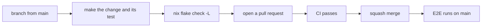

# Contributing to mix

Thanks for wanting to help. Bug reports, fixes, tests and documentation are all welcome. This page explains how to get a change from your machine into `main`, and what to expect on the way.

> [!IMPORTANT]
> Found a security problem? Do not open an issue or a pull request. Follow [SECURITY.md](SECURITY.md) instead.

## The short version



1. Branch from `main`. Do not push to `main`.
2. Change the code and add the test that covers it.
3. Run `nix flake check -L`.
4. Open a pull request with a title in commit format (see [Commits](#commits)).
5. Fix whatever CI reports in the same pull request.

## Set up

You need Nix with flakes enabled. Everything else comes from the repository.

```sh
nix develop          # Rust toolchain from rust-toolchain.toml
lefthook install     # git hooks, if lefthook is on your PATH
```

Plain `cargo` works inside that shell:

```sh
cargo build
cargo clippy --workspace --all-targets
cargo test --workspace
```

<details>
<summary>How the workspace is laid out</summary>

| Crate | Responsibility |
|---|---|
| `core` | The model and the operations (install, update, repair and so on). |
| `cli`, `daemon` | The two programs: `mix` and `mix-daemon`. |
| `shell`, `fs`, `home`, `exec` | Performing effects: running programs, changing files, working inside a user's home. |
| `nixgen` | Writing the Nix files that `mix` manages. |
| `rpc`, `events` | The requests and results that travel between the programs. |
| `render`, `ui`, `explain` | Output, and the text of the failure codes. |
| `nixlog` | Turns Nix's build log into progress counters. |
| `pins` | Pinned versions and checksums of Nix and nixpkgs. |
| `conformance` | Checks `mix`'s model against real programs. |
| `testchild` | A helper program that tests start as a child process. |

</details>

## Checks

CI runs `nix flake check` on x86_64 and aarch64. Run the same command before you push:

```sh
nix flake check -L
```

The git hooks run smaller parts of it for you, so most problems show up before you push:

| When | What runs |
|---|---|
| Before a commit | `fmt` for Rust, `ruff` when Python changed. When a `Cargo.toml` or `Cargo.lock` changed, `deny`, and an update of the fuzz crates' own `Cargo.lock` files that is added to the commit. |
| On the commit message | The commit message check. |
| Before a push | `doc` and `clippy`. |

Some workflows run by themselves. Cargo Audit and Zizmor run on every pull request. Fuzzing, property tests, benchmarks and the reproducibility check run on `main`.

## Tests

| Kind | Where | Rule |
|---|---|---|
| Unit and integration | `cargo test` | Hermetic. They must not need git, Nix, systemd or any other host program. |
| Real-binary behavior | `crates/conformance` | The home for any test that needs a real program. |
| End to end | `e2e/` | A systemd container driven by pytest. Needs `podman`, `uv` and `nix`. |

```sh
e2e/run.sh
```

> [!WARNING]
> The `mix-conformance` binary changes accounts, units and files on the system it runs on. Run it only inside the E2E container.

The end-to-end tests are slow, so CI runs them after a change merges to `main`, not on the pull request. Run them locally if you change behavior they cover.

The tests run the static binaries that the flake builds, the same `mix` and `mix-daemon` a release ships. Nix builds only the files git knows about, so add a new file with `git add -N` before you run them.

Write the test that would have caught the bug before you fix it, and name each test after the behavior it checks.

## Code

- Follow the style of the code around your change.
- Keep the code self-documenting. Clear names, types and tests do the explaining, and the existing code is written without comments. Help text on command-line arguments is the exception, because `clap` shows it to users.
- Prefer a mechanism over a guessed number. Where a timeout, retry count or threshold would be a guess, look for backpressure, a stop event or a measurement instead.
- Code that touches files or subprocesses has to hold up under failure: no deadlocks on full pipes, no dependence on the caller's umask, no temporary-name collisions, and a directory synced after a rename.
- Reads and writes in a user's home go through the `home-files` agent, which runs as that user and never as root.

## Commits

Every commit is a single conventional-commit line:

```
type: subject
type(scope): subject
```

The `commit-msg` hook enforces this, because pull requests are squash-merged and each title becomes a commit on `main`. The detail of a change belongs in the pull request description, not in the commit.

- The type is one of `feat`, `fix`, `refactor`, `ci`, `perf`, `test`, `chore` or `docs`.
- The subject is 50 characters or fewer, in lowercase imperative.
- A scope must be the exact name of a file or folder in the commit, such as a crate name. If the commit touches more than one crate, use `crates` or leave the scope out. If it touches `.github/` and anything else, leave the scope out.
- A commit that only touches `.github/` uses `ci`.

> [!TIP]
> Count the length before you commit: `echo -n "fix: handle a stale lock" | wc -c`. The hook rejects anything over 50.

## Pull requests

- The title follows the commit rules, because the pull request is squash-merged and the title becomes the commit.
- Fill in the template: a one or two sentence summary, and `Fixes #<issue>` if there is an issue.
- If users can notice the change, add a line for it under `Unreleased` in [CHANGELOG.md](CHANGELOG.md), with a link to the pull request. Changes to CI, tests or tooling get no line.
- Keep a pull request to one change. Split unrelated work.
- If your branch builds on another pull request, rebase it after the base merges. Squash-merging rewrites history, so use `git rebase --onto main <old-base> <branch>`.

## Dependencies

Renovate opens dependency updates. If one fails to build, fix it in your own pull request instead of editing Renovate's branch, then close the Renovate pull request once yours merges.

Check a new dependency against the `deny/` configuration before you add it. `cargo deny` runs in CI.

## Reproducible builds

Release binaries are built with Nix and checked for bit-for-bit reproducibility. If you change how they are built, make sure this still passes:

```sh
nix build -L --rebuild .#packages.<system>.default
```

## License

By contributing, you agree that your work is licensed under the [MPL-2.0](LICENSE).
