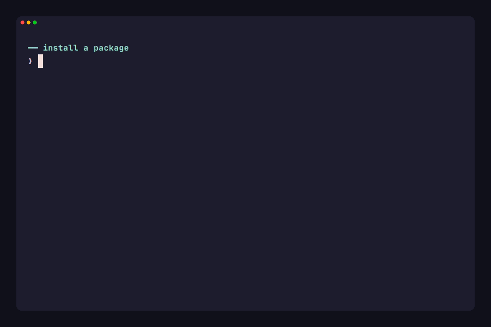
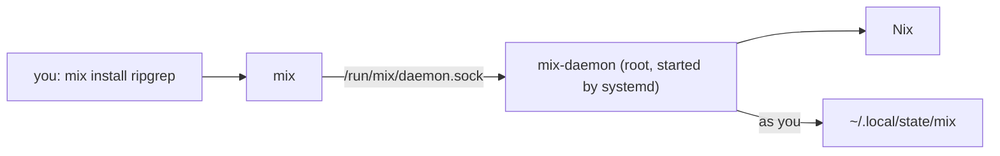

# mix

Reproducible systems, made effortless.



`mix` lets you install packages on an ordinary Linux machine and get the guarantees Nix is known for: the same package list gives the same result, upgrades don't break what you have, and every change can be traced. You get this without installing Nix by hand and without writing any Nix.

```sh
mix install ripgrep fd
mix list
mix update
```

> [!WARNING]
> `mix` is at `v0.1.0-alpha`. Commands, files and failure codes may change between releases. Try it on a machine you can afford to set up again.

## Why this exists

Nix is a good package manager. Packages never overwrite each other, a failed install leaves nothing half-done, and your setup can be described exactly. But if you run Ubuntu, Debian, Fedora or Arch, using it means:

- running an installer that edits system files, creates build users and sets up a daemon, and then hoping you can undo it later,
- learning flakes and Home Manager, and writing a configuration in the Nix language, before you can install your first tool,
- sorting out by yourself what to do when a step fails halfway.

NixOS avoids all of that by making Nix the whole system, but most people can't or won't replace their OS for it.

`mix` takes the other route. It treats Nix as an implementation detail. You say which packages you want, and `mix` does the setup, writes and keeps the configuration, and cleans up after itself, including when you remove it.

## What using it looks like

Setting up `mix` and removing it from the whole machine need administrator rights. Everything else, including leaving on your own, runs as your own user and never asks for `sudo`:

- `mix install` and `mix remove` change your package list.
- `mix list` shows what you have.
- `mix update` moves you to newer versions.
- `mix clean` frees the space old versions used.

Your packages belong to you alone. Another user on the same machine has their own list, and your installs don't affect theirs.

### You can see what changed

Your configuration is a small git repository at `~/.local/state/mix`. Every `mix` command that changes it leaves a commit, so `git log -p` there shows what changed and when. You never have to edit it, but you can read it.

### It recovers from failure

Package managers get interrupted: the network drops, the laptop sleeps, the terminal closes. `mix` writes down what it is about to do before it does it. If a request is interrupted, the next run finishes it or undoes it first, so you don't end up with a half-applied change. Use `--dry-run` on any command to see what it would do before it does it.

### It tells you what went wrong

Failures come with a short code and an explanation in plain language:

```sh
mix explain network
mix explain --list
```

`mix doctor` checks that the machine and your configuration are healthy, and `mix repair` fixes drift, such as a file that was changed or deleted by hand.

### It leaves when you ask

```sh
mix user remove
```

This removes `mix` from your account and leaves everyone else's alone. It needs no `sudo` and asks for confirmation first. When you are the last user on the machine, it then offers to remove Nix from the machine as well.

To remove `mix` and Nix for everyone, an administrator runs:

```sh
sudo mix purge
```

The point of the tool is that trying it is not a one-way decision.

> [!CAUTION]
> `mix purge` removes the `mix` state of every user on the machine, not only yours. The confirmation names each enrolled user. It also clears `mix` state left in the home of a former user, and `--dry-run` shows everything that goes before anything does.

## Try it

You need a Linux machine with systemd, on x86_64 or aarch64, and `sudo` for the install and the setup. It must not be NixOS and must not already have a Nix that `mix` did not install.

### Install with the script (recommended)

```sh
curl -fsSL https://mix.recregt.com/install.sh | sh
```

The [script](scripts/install.sh) downloads the newest release for your architecture, checks it against its published checksum and puts `mix` and `mix-daemon` into `/usr/local/bin`. It uses `sudo` for that one step and changes nothing else. To install a specific release, give the script its tag:

```sh
curl -fsSL https://mix.recregt.com/install.sh | MIX_VERSION=v0.1.0-alpha.3 sh
```

### Install by hand

Download the archive and its checksum for your architecture from the [releases page](https://github.com/recregt/mix/releases), check one against the other and put both programs into the same directory on your `PATH`. `mix` finds `mix-daemon` next to itself.

```sh
sha256sum -c mix-x86_64-linux.tar.gz.sha256
tar -xzf mix-x86_64-linux.tar.gz
sudo install -m 0755 mix-x86_64-linux/mix mix-x86_64-linux/mix-daemon /usr/local/bin/
```

### Set it up

1. See what setup would do, then do it. The setup asks for administrator rights once. It downloads Nix, so on a clean machine it can take several minutes.

   ```sh
   mix bootstrap --dry-run
   mix bootstrap
   ```

2. Bootstrap ends by printing one command that makes your installed packages visible in the shell you are already in. Run it, then install something.

   ```sh
   source /etc/profile.d/mix-nix.sh
   mix install ripgrep
   rg --version
   ```

   New terminal sessions pick the packages up on their own. The `source` line is only for the session you ran `bootstrap` in.

3. When you are done looking around, leave. If you are the only user, it offers to remove Nix from the machine too.

   ```sh
   mix user remove
   ```

   Terminal sessions opened before the removal still load Nix. `exec $SHELL -l` starts one without it.

> [!NOTE]
> CI runs `mix` against a systemd container based on Ubuntu 24.04. Other distributions with systemd should work but nobody has tested them yet.

## What it is not

- **Not a replacement for Nix.** If you already use Nix, flakes or Home Manager, you don't need `mix`, and `mix` will refuse to set itself up next to a Nix it did not install.
- **Not for NixOS.** NixOS already does this natively.
- **Not a place to write your own Nix.** `mix` manages the configuration file for you. Hand edits to it are what `mix repair` is for.
- **Not for macOS or Windows.** Linux only for now. WSL 2 works in principle because it can run systemd, and WSL 1 does not.

## How it works



`mix bootstrap` downloads a pinned release of Nix, verifies it against a checksum built into `mix`, and sets up a multi-user Nix with a systemd service. A small privileged daemon, `mix-daemon`, does the work that needs root. Your own packages are built with [Home Manager](https://github.com/nix-community/home-manager) and a pinned revision of nixpkgs, from the configuration in `~/.local/state/mix`.

The privileged part stays small on purpose, and it is the part [SECURITY.md](SECURITY.md) describes.

<details>
<summary>Where things live</summary>

| Path | What it holds |
|---|---|
| `/usr/local/bin/mix`, `/usr/local/bin/mix-daemon` | The programs, where you installed them. |
| `/nix` | The Nix store and its state. |
| `/etc/mix/policy.json` | Machine-wide settings, such as the mirror. |
| `/etc/nix/nix.conf`, `/etc/profile.d/mix-nix.sh` | Nix configuration and the shell setup that puts your profile on `PATH`. |
| `/etc/systemd/system/mix-daemon.{socket,service}` | The service that runs privileged work. |
| `/var/lib/mix` | The daemon, its lock and its journal of in-progress requests. |
| `~/.local/state/mix` | Your configuration: a git repository with `flake.nix`, `home.nix`, `flake.lock` and `state`. |

</details>

<details>
<summary>Mirrors</summary>

If a machine can't reach the public caches, point `mix` at a mirror when you bootstrap:

```sh
mix bootstrap --mirror https://mirror.example.com --mirror-key <public key>
```

`MIX_NIX_MIRROR` and `MIX_NIX_MIRROR_KEY` work too. The mirror applies to every user, and its key is trusted machine-wide. A mirror holds the versions your copy of `mix` was released with, so `mix update` goes no further than that. Update `mix` to get newer packages.

</details>

<details>
<summary>Command reference</summary>

| Command | What it does |
|---|---|
| `mix bootstrap` | Set up `mix` and Nix on this machine. |
| `mix install <packages>` | Add packages to your profile. |
| `mix remove <packages>` | Remove packages from your profile. |
| `mix list` | List the packages you have installed. |
| `mix update` | Update your packages to the newest versions. |
| `mix clean [--all]` | Remove old generations. `--all` also removes store paths nothing uses. |
| `mix doctor` | Check the health of the system. |
| `mix repair` | Repair configuration drift. |
| `mix explain [code]` | Describe a failure code, or list them all with `--list`. |
| `mix user remove` | Remove `mix` from your account, with no `sudo`. |
| `mix purge` | Remove `mix`, Nix and every user's state from the machine. |

Every command accepts `-v`, `-q`, `--json`, `--no-progress` and `--color`. Commands that change something also accept `--dry-run`. Package commands can't run as root. Run them as your own user.

</details>

## Contributing and security

Read [CONTRIBUTING.md](CONTRIBUTING.md) before opening a pull request. Report vulnerabilities as described in [SECURITY.md](SECURITY.md), not in public issues.

## License

[MPL-2.0](LICENSE)
